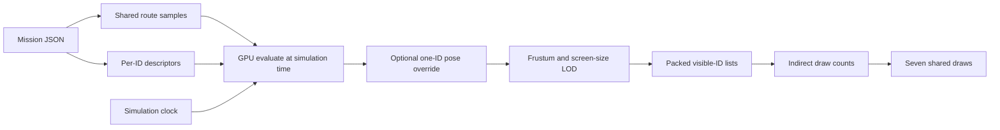

# Architecture

Updated 2026-10-29. This document describes the implemented experimental v0.1.0 runtime.
For setup see the [README](../README.md); for layouts see [data structures](data-structures.md)
and for evidence boundaries see [testing](testing.md).

## Scope

Million Drones is a static browser application. The current simulation runs analytic routes
for up to one million stable individual IDs. Three prepared drone designs share GPU evaluation,
culling and level of detail. Greater London supplies a fully local ODbL visual map and offline
model-clearance inputs. There is no required application server, database or simulation worker.

The design separates simulation membership from visual detail: changing camera, map residency
or quality does not change an ID's route progress or the selected active population.

## Package responsibilities

| Location | Responsibility |
| --- | --- |
| [apps/sky](../apps/sky/src/main.ts) | Compose the renderer, simulation clock, DOM controls, cameras, maps, guides and optional diagnostics. |
| [core-types](../packages/core-types/src/index.ts) | Tuple types, packed strides, descriptor flags, deterministic hashing and stable design assignment. |
| [flight](../packages/flight/src/index.ts) | Pure route compilation/evaluation, simulation clock, selected-ID pilot/return maths and gamepad input normalization. |
| [city](../packages/city/src/index.ts) | Geographic frame, mission compilation, obstacle/model-clearance helpers and deterministic fleet descriptors. |
| [render](../packages/render/src/index.ts) | Three.js WebGPU/TSL compute, shared meshes, LOD, indirect draws, picking and optional collision snapshots. |
| [metrics](../packages/metrics/src/index.ts) | Timing summaries. |
| [tools](../tools) | Offline map/model preparation and source/report checks. |

Pure flight/core contracts have no DOM or Three.js ownership. The app composes package APIs;
the renderer does not import app UI. [Boundary checks](../tools/sky/check-boundaries.mjs)
enforce implemented dependency rules and reject cycles.

## Automatic flight pipeline

Setup compiles missions and creates descriptors once. Each frame advances the simulation clock,
updates clock/camera uniforms, and dispatches GPU pose evaluation for every active ID. Culling
and LOD then select how visible drones are drawn. Position/orientation are derived from shared
route samples; there is no per-drone JavaScript frame update or scene object.

ID is the descriptor array index. Design is `id % 3`, independent of camera and quality. Full
and silhouette draws exist for each of the three designs, plus one shared marker draw. Shared
detail caps are 4,096 full and 32,768 silhouette instances; excess detail falls back to markers.
LOD history supplies hysteresis. Small stats buffers and explicit audits provide count readback.

## Coordinates, clock and mission semantics

Use local metres: X east, Y up, Z south. London uses a shared EPSG:27700 origin; GPU positions
remain local. Heights use nominal flat ground and modelled/estimated roofs, not surveyed terrain.
Orientation uses normalized XYZW quaternions; label Euler angles are derived in YXZ order.

One simulation clock governs route progress, rotor animation, pilot integration and return.
Pause freezes simulation time. Real frame delta is clamped before applying time scale. Packed
timestamps use milliseconds; pure maths uses seconds. Ordinary routes use distance progress;
launch routes use time progress in the same sample layout. See the explicit conversion and
flag contracts in [data structures](data-structures.md).

Current London assigns 30% scheduled ground/roof missions and 70% seeded roaming at supported
populations divisible by ten. Eleven launch routes include holds, takeoff, travel, landing and
return; 480 roaming routes form 120 groups. This assignment does not imply simultaneous ascent,
traffic capacity, avoidance or continuous separation.

## Selection and manual flight

Selection is a stable-ID uniform, a label and small route guides. On-demand GPU picking scans
the pose buffer and reads back a bounded result; it does not create CPU objects for the fleet.
Follow shifts the camera/target with the selected effective pose while preserving orbit/zoom.

Exactly one existing ID may have a CPU pilot or return state. Take control captures its effective
position, velocity and orientation. Nonzero inherited velocity coasts until movement/braking;
keyboard/gamepad input uses fixed 1/60-second simulation ticks and held-input ramps. Focus/device
loss clears input and ends inherited coasting. Manual motion has a conservative nominal-ground
floor, without terrain/building avoidance.

The resulting pose is supplied as one uniform override before culling, picking and collision
inspection. Return blends back toward the moving route. Selection can move to another ID during
that return; a second independent pilot cannot be created. Counts and descriptor identities stay
unchanged. [Manual flight](../packages/flight/src/manual.ts) remains separate from automatic routes.

## Maps and optional live imagery

London manifest/overview/fleet JSON are build inputs. Script-wrapped detail tiles ship locally
beside both static builds. A bounded visual cache allows four pending and 32 resident detailed
tiles. Eviction releases owned geometry and label textures while retaining shared materials.
Route/model-clearance proofs bind to the full local dataset hash and do not depend on which
visual tiles happen to be resident.

Optional Google Photorealistic 3D Tiles connect explicitly through Cesium ion or a manually
provided Google key. They remain live visual content with provider attribution and local-map
fallback. Google geometry is never route or collision input. The build-time Cesium token is
intentional public browser configuration; env files and administrative credentials are not source
assets. Source provenance/licences remain with the [map](../apps/sky/public/london/README.md),
[models](../assets/drones/sources.json) and [runtime notices](../apps/sky/public/licenses/README.md).

## Diagnostics, lifetime and limits

Collision monitoring is off by default. A capped GPU hash-grid snapshot reports contact/near
counts, including truncation/completeness. It does not alter motion or certify avoidance,
continuous separation, terrain/building contact or real-aircraft safety.

Scenario/population resets clear selected control and dispose renderer-owned storage, picking
resources and diagnostics. Preserve the pinned Three.js 0.186.1 storage-release bridge: disposing
a BufferAttribute alone did not free compute-only buffers. GPU lifetime audits are distinct from
source checks. Streamed resources are frozen for allocation/correctness audits.

Stateful steering, formations, live replanning, surveyed terrain and an external DRTE file loader
remain future work. Current mixed-fleet browser/GPU, physical-controller, device performance and
soak acceptance remain pending. Historical single-model timing cannot establish current results.
