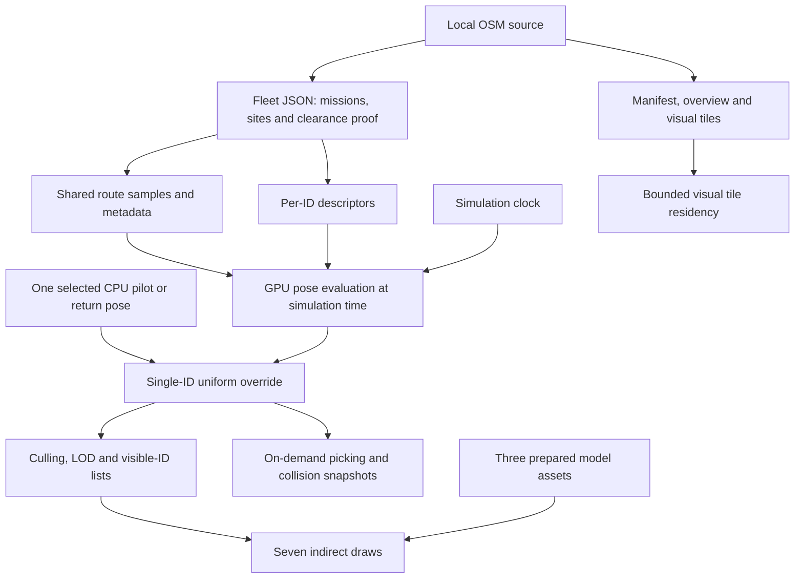

# Data structures

Updated 2026-10-29 for the current v0.1.0 implementation, including motion-preserving takeover.
Start with the [reading guide](readness.md) for project orientation. This reference describes
implemented data. An external DRTE binary container is a future design; no DRTE reader/writer,
scheduler worker or formation-state pipeline ships yet.

## 1. Data flow and ownership



| Layer | Representation | Owner / lifetime |
| --- | --- | --- |
| Source/provenance | JSON manifests, original GLBs, local tile scripts | Checked-in assets; tools regenerate explicit outputs. |
| Scenario | Mission objects, compiled `RouteTable`, descriptor typed array | CPU, created at scenario/population setup; not updated per drone every frame. |
| Automatic motion | Derived pose storage | GPU, evaluated for every active ID from clock and descriptors. |
| Manual motion | One `PilotState` or `ReturnState` | CPU; effective pose replaces the same ID in GPU storage. |
| Visibility | LOD history, packed ID lists, counters, indirect arguments | GPU, camera-dependent derived state. |
| City detail | Resident/pending tile maps and owned geometry/textures | App; bounded cache independent of simulation state. |

There is no stored JavaScript object containing every drone's live position/velocity. Stable ID
is the index `0..N-1` of its descriptor. `N` is the explicitly selected active population.

## 2. Shared units and identity

Source: [core types](../packages/core-types/src/index.ts),
[drone types](../packages/core-types/src/drone-types.ts).

| Value | Contract |
| --- | --- |
| `Vec3` | `[x, y, z]`, local metres; X east, Y up, Z south for London. |
| `Quat` | `[x, y, z, w]`, normalized orientation; model forward is local −Z. |
| Time | Seconds in flight maths; unsigned milliseconds in packed descriptors/GPU time. |
| Speed | Metres/second in ordinary routes/manual state; display converts to km/h with `× 3.6`. |
| Angles | Radians internally; selected label derives roll/pitch/yaw in degrees using YXZ decomposition. |
| Geographic origin | EPSG:27700 easting 537273, northing 180348. `x = easting − origin.easting`; `z = origin.northing − northing`. |
| Height | Nominal local ground Y=0 plus estimated/modelled building heights; no surveyed terrain datum. |
| Drone design | `id % 3`: 0 sci-fi, 1 quadcopter, 2 inspection. Not stored in the descriptor. |

At 1M IDs the design counts are 333,334 / 333,333 / 333,333. The common prepared swept envelope
radius is 1.027 m. These are demo asset dimensions, not physical aircraft specifications.

## 3. Per-drone descriptor — 32 bytes

Source: [descriptor generation and CPU evaluation](../packages/flight/src/index.ts),
[London cohort assignment](../packages/city/src/fleet.ts).

Each record is eight 32-bit words. A `Uint32Array` and `Float32Array` view share the same
`ArrayBuffer`: float fields are bit-reinterpreted on the GPU, not numerically cast from integers.
Record `id` starts at word `id * 8`.

| Word | Byte | Type | Meaning |
| ---: | ---: | --- | --- |
| 0 | 0 | u32 | Route index into metadata / `RouteTable.routes`. |
| 1 | 4 | u32 | Deterministic seed, not the drone ID. |
| 2 | 8 | f32 | Initial route progress at reference time. |
| 3 | 12 | u32 | Reference/start time in simulation milliseconds. |
| 4 | 16 | f32 | Progress rate: normally m/s; launch timetable uses 1 virtual unit/s. |
| 5 | 20 | f32 | Frame-right offset, or world-X offset when bit 0 is set. |
| 6 | 24 | f32 | Frame-up offset, or world-Z offset when bit 0 is set. |
| 7 | 28 | u32 | Flags: bit 0 `WORLD_XZ_OFFSETS=1`; bit 1 `SCHEDULED_START=2`. |

For scheduled starts, elapsed seconds are `max(0, currentMs − startMs) / 1000`. Otherwise the
CPU uses the unsigned elapsed millisecond difference, then divides by 1000. Progress is
`initialProgress + rate * elapsedSeconds`. Closed routes wrap; open routes clamp. The packed
clock contract requires session reset/rebasing before long-running wrap ambiguity; sessions must
remain below 2³¹ milliseconds.

Current London cohorts use `id % 10 < 3` for launch missions, the other IDs for roaming. This
gives exactly 30%/70% at supported populations divisible by ten; it is not a simultaneous flying
or takeoff count. Launch offsets scatter in world X/Z within the smaller endpoint pad radius,
start times are seeded within the first 120 seconds, and flags are `1 | 2`. Roaming descriptors
use route-frame offsets up to ±18 m right and ±10 m up, seeded group phase and small speed variation.

Example for inspecting a record without copying its buffer:

```ts
const at = id * 8;
const floats = new Float32Array(words.buffer, words.byteOffset, words.length);
const routeIndex = words[at];
const progressRate = floats[at + 4];
const flags = words[at + 7];
// Read orientation/position using poseAt(words, table, id, timeMs).
```

Do not interpret launch progress rate `1` as actual speed 1 m/s. Its position samples encode
takeoff, eased travel, landing and holds; speed telemetry comes from effective motion.

## 4. Shared routes — metadata and samples

Source: [Route, RouteTable, routeTable and evaluateRoute](../packages/flight/src/index.ts),
[launch compilation](../packages/city/src/fleet.ts).

```ts
interface Route {
  samples: Float32Array;
  length: number;
  spacing: number;
  closed: boolean;
  speed: number;
}
interface RouteTable {
  samples: Float32Array;   // Concatenated samples for all routes.
  metadata: Uint32Array;  // Eight words per route, with shared float view.
  routes: Route[];        // CPU reference routes.
}
```

Metadata is 32 bytes per route:

| Byte | Type | Current stored value |
| ---: | --- | --- |
| 0 | u32 | First sample index, measured in samples, not bytes/floats. |
| 4 | u32 | Sample count, including terminal sample. |
| 8 | f32 | Progress extent (`length`). |
| 12 | f32 | Uniform progress spacing (`spacing`). |
| 16 | u32 | Closed=1; open=0. |
| 20 | f32 | Route's nominal speed/progress rate. |
| 24 | f32 | `-1`: clearance unknown in this field. Proofs live separately. |
| 28 | u32 | Reserved zero. |

Each sample is 48 bytes: twelve f32 values / three `vec4` values.

| Float indices | Meaning |
| --- | --- |
| 0–2; 3 | Local position X/Y/Z; progress coordinate. |
| 4–6; 7 | Forward/attitude direction; nominal speed/progress-rate value. |
| 8–10; 11 | Right direction; clearance placeholder (`-1` in current compilers). |

The evaluator finds a bounded interval from progress/spacing, interpolates position and frame,
orthogonalizes right against forward, and derives up from `cross(right, forward)`. The metadata
speed/sample speed fields are not an automatic per-sample speed limiter in the current evaluator.

Ordinary routes sample distance in metres. London launch routes sample a timetable at intervals
no greater than 0.5 seconds: one virtual progress unit equals one second, so `length` represents
duration and `spacing` represents time. They share the storage format, not the distance semantics.
City routes store a horizontal body heading even on climbs/vertical legs; attitude direction
therefore need not equal the full 3D position derivative. Closed routes duplicate the starting
position/frame at the final progress coordinate to support seam interpolation.

## 5. London files, missions and map tiles

### Files and proof relationship

| Location | Contents / role |
| --- | --- |
| `assets/city/london/{manifest,overview,fleet}.json` | Imported into the app bundle at build time. |
| `apps/sky/public/london/` | Public map distribution, including manifest, fleet, overview and 1,820 tile scripts. Copied beside both builds. |
| `tiles/<x>_<z>.js` | Detail data delivered through `__londonTileLoaded(key, data)`, compatible with local-file use. |

The current default London scenario uses `fleet.json`; earlier road-navigation bundles are not
the current 30% launch / 70% roaming scenario. `LondonManifest` and `FleetBundle` TypeScript
interfaces describe the consumed subset; JSON also contains provenance/licence/report fields.

Manifest fields include `schemaVersion`, `region`, geographic `origin`, `bounds`, `tileSizeM`,
`tiles`, `maxRoofM`, `dataSha256`, source hash/timestamp and attribution/licence. Each tile entry
has `{key, x, z, file, bytes, sha256, buildings, roads, areas}`. Preserve per-tile hashes and the
whole-dataset identity when regenerating data.

`FleetBundle` contains `{schemaVersion, dataSha256, contentSha256, missions, sites, validation}`.
`dataSha256` binds the scenario proof to the map; `contentSha256` is generated from
`JSON.stringify({missions, sites, validation})`, not the entire fleet file. `londonFleet()` checks
schema/map identity, proof status, hash shape and the compiled segment count. It does not itself
rehash every tile or recompute the fleet content hash in the browser. Those belong to offline
generation/audits; do not describe a stored hash as a runtime verification that did not occur.

### Mission objects

Source: [fleet contracts](../packages/city/src/fleet.ts).

| Type | Main fields |
| --- | --- |
| `LaunchSite` | `id`, `name`, `kind: ground/roof`, `position: Vec3`, `radiusM`, `surfaceHeightM`, `sourceIds`, `supportIds`. |
| `RoamMission` | `kind: roam`, `movement: vertical/wandering`, `label`, `group`, `waypoints: Vec3[]`, `spacing`, `speed`. |
| `LaunchMission` | `kind: launch`, `label`, `from/to: LaunchSite`, `cruiseAltitudeM`, `cruiseSpeedMps`, `climbSpeedMps`, `groundHoldS`, `repeat`. |
| `LaunchStage` | `name`, `startS`, `endS`, endpoint positions `a/b`, heading angles `headingA/headingB`. Derived during compilation/UI explanation. |

Current data has 491 missions: 480 roaming routes in 120 groups and 11 launch routes, using
five ground and six roof sites. Validation records segment counts, source-tile coverage,
clearance/tolerance values and explicit supporting-surface contact. This is model clearance,
not drone separation or surveyed ground/obstacle accuracy.

### Compact tile data

Source: [tile generation](../tools/london/build-map.mjs),
[tile consumption](../apps/sky/src/london-scene.ts).

```ts
type Rings = number[][][];  // Polygon rings -> [x,z] points.
type Building = [osmId: string, base: number, top: number, flags: number, rings: Rings];
interface TileData {
  key: string;
  x: number;  // Signed tile index east.
  z: number;  // Signed tile index south.
  b: Building[];
  r: [roadClass: number, points: number[][], name: string][];
  a: [kind: string, rings: Rings][]; // Water/green polygons.
}
```

Tile width is 1,024 m. Polygon/road points are tile-relative X/Z; the renderer adds
`[tile.x * 1024, 0, tile.z * 1024]`. Building base/top remain heights in the shared local frame.
Flags retain source/height-estimation information; see the generator before interpreting bits.
Overview data contains citywide areas/road segments, named places and coarse landmark buildings.
Detailed visuals use at most 32 resident tiles and four pending loads. Eviction disposes owned
geometry/label textures and preserves shared materials. Visual residency never changes missions.

## 6. Derived GPU data and rendering counts

Source: [renderer](../packages/render/src/index.ts),
[draw layout](../packages/render/src/draw-layout.ts).

| Buffer | Layout |
| --- | --- |
| Poses | 32 bytes/ID: `vec4(position.xyz, 1)` then `vec4(quaternion.xyzw)`. Derived, not a persistent velocity record. |
| LOD history | One u32/ID: 0 full, 1 silhouette, 2 marker. Supports screen-size hysteresis. |
| Visible IDs | Three bounded full lists, three bounded silhouette lists, one N-capacity marker list. Values are original IDs. |
| Model draw counters | Six u32 counters, one per model/LOD draw. |
| Aggregate counters/stats | Five u32: `[full, low, marker, visible, overflow]`. Scratch counters reset after writing stats/arguments. |
| Indirect arguments | Seven indexed-draw records, each five u32: `[indexCount, instanceCount, firstIndex, baseVertex, firstInstance]` (baseVertex has signed API semantics). |
| Picking state | Two atomic u32 words for nearest-distance selection and stable-ID tie resolution; read on demand. |

Draw order is full types 0/1/2, silhouette types 0/1/2, shared markers. Full-detail cap is
`min(N,4096)` across all types; silhouette cap is `min(N,32768)` across all types. A filled
model bucket falls back to markers. The caps are shared even though each type has a separately
allocated list of that capacity. Never count seven draws as seven copies of a drone.

For N≥32,768, these population-dependent storage arrays use `72N + 442,368` bytes: descriptors
32N, poses 32N, LOD 4N, marker IDs 4N, plus the six bounded model ID lists. This excludes routes,
geometry, counters, render targets, readback/driver overhead and optional collision buffers;
it is an allocation formula, not a measured memory/performance result.

Prepared model JSON contains provenance, bounding radius, rotor pivots and two `lods`. Each LOD
contains `triangles`, flat XYZ arrays `position/normal/color`, and a four-value `rotor` attribute
per vertex. The renderer shares these assets; it does not load a GLB per drone. Full/low triangle
counts are 360/36, 5,036/84 and 1,252/148. Original models/hashes/licences are in
[sources.json](../assets/drones/sources.json).

## 7. Selected drone, manual input and return

Source: [manual state](../packages/flight/src/manual.ts),
[gamepad state](../packages/flight/src/gamepad.ts), [app composition](../apps/sky/src/main.ts).

| Type | Fields / purpose |
| --- | --- |
| `FlightPose` | `position: Vec3`, `quaternion: Quat`. |
| `PilotInput` | Normalized axes `forward/right/up/turn/pitch`, plus `boost: boolean`. |
| `PilotState` | Pose plus `id`, target `yaw/pitch` radians, world `velocity` m/s, `coasting`, `attitudeHeld`, fixed-step `remainder` seconds and signed axis `held` durations. |
| `ReturnState` | `id`, positional `offset` from the route at handoff, captured `quaternion`, `elapsed/duration` seconds. |
| `PadSnapshot` | Browser device ID/index/mapping/connected status, axes and pressed/value button samples. |
| `PadProfile` | Four axis indices/inversions, eight button bindings, `allowUnmapped`. |
| `PadSession` | Device identity, neutral-arming `ready` state and previous action buttons for edge detection. |

Takeover copies the effective position, orientation and full velocity before clearing input.
Inherited velocity coasts until movement input or explicit braking takes over; attitude stays
held until an angular/level command. Pilot integration uses 1/60-second simulation ticks and
four-second held-input ramps. Return blends a decaying offset toward the route's current pose.

The GPU receives only one manual/return ID and pose uniforms; disabled ID is `0xffffffff`.
The override runs before culling, picking and collision inspection. Selection ID is independent:
another drone can be selected while the old one returns. There is no duplicate drone or population
change. Gamepad profiles/device identifiers are not persisted/exported by the current app.

Telemetry is derived for the selected effective pose at a capped UI rate. Automatic/return speed
uses a 50 ms forward position sample; manual speed uses velocity magnitude. Label Euler angles
are derived from quaternion and are not additional authoritative orientation state.

## 8. Optional collision snapshots and validation boundaries

Source: [GPU collision monitor](../packages/render/src/collisions.ts).

The optional monitor owns a hash-grid `heads` u32 array (default 2²⁰ entries), one linked-list
`links` u32/ID and six counters: fleet contact pairs, fleet near pairs, selected contacts,
selected near neighbours, truncated queries, selected truncation flag. Empty link is
`0xffffffff`; cells are `floor(position / 4)` in all three axes, including negative coordinates.
Default traversal is capped at 256 visits/query. Contact threshold is twice the 1.027 m envelope;
near neighbours occupy the remaining shell out to 4 m.

`CollisionStats` adds scope, population, selected ID, thresholds, query count and
`complete/selectedComplete`. Selected-only scope does not compute fleet-wide pair totals.
Truncated searches report partial/lower-bound results. These are discrete snapshots of effective
drone poses, not continuous collision detection, avoidance or building/Google-geometry checks.

For changes to these contracts, use the relevant source fixtures and CPU/GPU agreement/count/
boundary/lifetime audits. Source tests and generated WGSL do not establish GPU execution.
See [testing](testing.md) for commands and acceptance boundaries. Current browser/GPU,
controller and soak acceptance remain separate pending gates.
